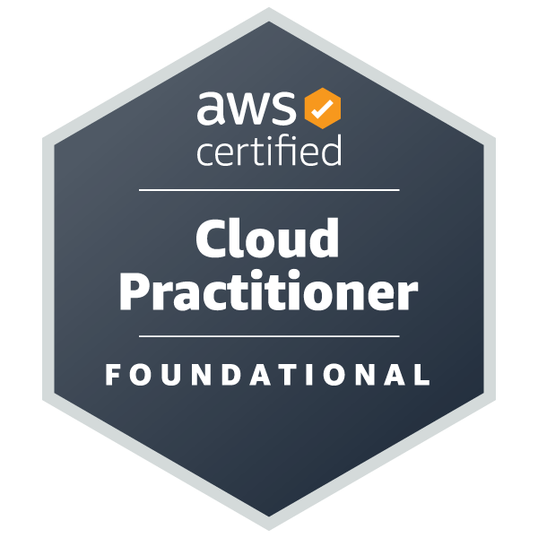
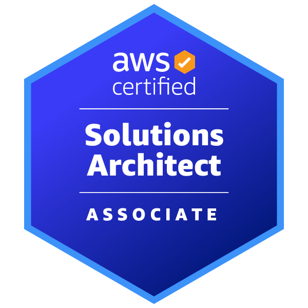

<!--
  Profile README — Rakesh Kaklotar
  Stats are refreshed daily by .github/workflows/update-stats.yml
-->

<div align="center">

# Rakesh Kaklotar

**Senior Full Stack Engineer · AI Systems · Cloud Architecture**  
AWS Certified · 10+ Years Shipping Production Software

[Portfolio](https://rakesh.kaklotar.com/) · [LinkedIn](https://www.linkedin.com/in/rakesh-kaklotar/) · [Credly](https://www.credly.com/users/rakesh-kaklotar.b311503c/public_url)

<br/>


</div>

---

## About

I design and deliver **scalable SaaS products, AI-powered platforms, and cloud-native systems** — from architecture through production.

Over **10+ years**, I’ve worked across the full stack: frontend architecture, backend services, data layers, cloud infrastructure, CI/CD, and system design. Recently I’ve been investing deeply in **AI engineering with Python** — LLM apps, RAG pipelines, agents, and automation that ship to real users.

I care about software that is performant, maintainable, secure, cost-aware, and aligned with business outcomes.

---

## Focus Areas

| Domain | What I build |
| --- | --- |
| **AI & Intelligent Systems** | LLM integrations, RAG, agents, voice AI, OCR / document intelligence, AI workflows |
| **Python Engineering** | FastAPI services, AI/ML pipelines, data processing, automation, backend APIs |
| **Full-Stack Products** | React / Next.js / Angular frontends with NestJS, Node.js, and .NET backends |
| **Cloud & DevOps** | AWS & Azure architectures, Docker, CI/CD, serverless, production operations |
| **Real-Time Systems** | WebSockets, WebRTC, collaboration, chat, notifications, live media |

---

## AI & Python

Building production AI is more than calling an API. I design **reliable pipelines** with retrieval, tooling, evaluation, and operational guardrails.

**Capabilities**
- LLM application architecture (chat, copilots, assistants)
- RAG systems — ingestion, chunking, embeddings, vector search, grounded answers
- AI agents — tool use, memory, orchestration, and workflow automation
- Voice AI, OCR, and document intelligence
- Knowledge bases and AI-powered SaaS features
- MCP / tooling integrations for agentic workflows

**Python stack I work with**

<p>
  
  
  
  
  
  
  
  
  
  
  
</p>

---

## Technology Stack

### Frontend
<p>
  
  
  
  
  
  
</p>

### Backend
<p>
  
  
  
  
  
  
  
</p>

### Data
<p>
  
  
  
  
  
  
</p>

### Cloud & DevOps
<p>
  
  
  
  
  
</p>

### Integrations
Stripe · PayPal · Braintree · Razorpay · Cashfree · Twilio · Google Maps · Algolia · Contentful · Strapi

---

## GitHub Analytics

> Auto-updated daily by GitHub Actions (`Update GitHub Stats` workflow).

<!-- Metrics SVG generated by lowlighter/metrics — appears after first successful workflow run -->
<div align="center">
  
</div>

<br/>

<div align="center">
  
  
</div>

<br/>

<div align="center">
  
</div>

<br/>

<div align="center">
  <picture>
    <source media="(prefers-color-scheme: dark)" srcset="https://raw.githubusercontent.com/Rakesh69/Rakesh69/output/github-contribution-grid-snake-dark.svg"/>
    <source media="(prefers-color-scheme: light)" srcset="https://raw.githubusercontent.com/Rakesh69/Rakesh69/output/github-contribution-grid-snake.svg"/>
    
  </picture>
</div>

---

## Certifications

<p>
  <a href="https://www.credly.com/badges/6df6dc93-a453-4926-8aa7-0271f1580f44">
    
  </a>
  &nbsp;&nbsp;
  <a href="https://www.credly.com/badges/8d158d2b-05e6-4f13-812b-0d53dc45517f">
    
  </a>
</p>

| Certification | Focus |
| --- | --- |
| **AWS Certified Solutions Architect – Associate** | Scalable, secure, cost-effective AWS architectures |
| **AWS Certified Cloud Practitioner** | Cloud fundamentals, security, architecture, and pricing |

[View all badges on Credly →](https://www.credly.com/users/rakesh-kaklotar.b311503c/public_url)

---

## Featured Work

Production-oriented work across **AI, Python services, SaaS, cloud, and real-time systems**.

### AI & Python
- **AI SaaS Platform** — Multi-tenant AI product architecture
- **RAG Platform** — Document ingestion, embeddings, retrieval, grounded LLM answers
- **AI Agent Platform** — Agent orchestration, tools, memory, and automation
- **Python API Services** — FastAPI backends for AI and data workloads

### Product & Architecture
- **SaaS Starter** — Production foundation for modern SaaS applications
- **NestJS / .NET Microservices** — Distributed backend architectures
- **Payment Service** — Provider abstraction across Stripe, PayPal, Razorpay, and more
- **System Design Examples** — Practical patterns for scale and reliability

### Real-Time & Cloud
- **Real-Time Collaboration** — WebSockets and collaborative app architecture
- **WebRTC Video Platform** — Live audio/video communication
- **AWS Serverless Platform** — Event-driven cloud architecture
- **Observability Platform** — Logging, monitoring, and operational visibility

---

## Engineering Approach

> Build the simplest solution that works. Scale when the business requires it.

**End-to-end ownership**

```text
Requirements → Architecture → Data & APIs → Frontend → Backend
     → AI / Integrations → Quality → Cloud Deploy → Observability
```

**What I optimize for**
- Clear system design and sensible trade-offs
- Performance, security, and maintainability
- Cloud cost awareness
- Developer experience and long-term operability
- Business impact over technology theater

---

## Open to Opportunities

Interested in roles and engagements around:

- Senior Full Stack / AI Engineering
- Python & AI platform development
- Cloud / AWS architecture
- Solution architecture & technical leadership
- SaaS product engineering
- Remote freelance and contract work

If you’re building an **AI platform, Python service layer, SaaS product, or scalable cloud system**, let’s talk.

---

<div align="center">

**Build. Scale. Automate.**

*Turning complex engineering problems into reliable production systems.*

<br/>

[rakesh.kaklotar.com](https://rakesh.kaklotar.com/) · [LinkedIn](https://www.linkedin.com/in/rakesh-kaklotar/) · [GitHub](https://github.com/Rakesh69)

</div>
